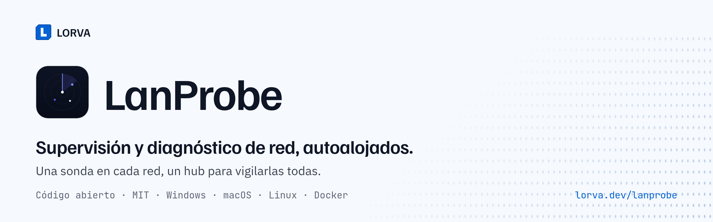

<p align="center"><a href="README.md">English</a> · <a href="README.fr.md">Français</a> · <b>Español</b></p>

<picture>
  <source media="(prefers-color-scheme: dark)" srcset="docs/assets/banner-es-dark.png">
  
</picture>

# LanProbe

[](https://github.com/Ops-Lorva/lanprobe/releases/latest)
[](#licencia)

**Supervisión y diagnóstico de red, autoalojados: una sonda en cada red, un hub para vigilarlas todas.**
Perfiles de interfaz, monitor de ping, SLA, descubrimiento, escaneo de puertos, prueba de velocidad y un hub autoalojado. Página del producto: [lorva.dev/lanprobe](https://lorva.dev/lanprobe/).

<!-- screenshot: hub dashboard — fleet overview with several sites and probes -->

---

## El problema

Vigilar una red suele obligar a elegir. Las suites de supervisión pesadas son desproporcionadas para un puñado de sitios. Los servicios en la nube quieren un agente que informe a los servidores de otro, y dan por hecho que se puede abrir una entrada. En el sitio de un cliente, en un laboratorio o en una red doméstica detrás de CGNAT, a menudo no se puede, y tampoco se quiere necesariamente que la topología viva en la nube de un proveedor. Mientras tanto, el diagnóstico del día a día sigue repartido entre una docena de utilidades de un solo uso: una para el ping, otra para escanear puertos, otra para recorrer la subred, otra para medir el caudal.

## Qué hace LanProbe

LanProbe reúne esas utilidades en una sola herramienta y vigila los equipos **desde dentro de la propia red**. Es **autoalojado y de código abierto**: las sondas funcionan en sus máquinas, el hub en un servidor que usted controla, y las mediciones nunca salen de su infraestructura.

Se compone de **dos piezas**, y conviene conocer el reparto antes de instalar nada:

| | Papel |
|---|---|
| **La sonda** | Mide. Aplicación de escritorio (Windows / macOS / Linux) o servicio headless. Hace ping, escanea y prueba la velocidad, desde dentro de la red vigilada. |
| **El hub** | Vigila. Un contenedor Docker en su propia máquina, que reúne todas las sondas tras **una sola dirección y una sola autenticación**. |

Una sonda sola es perfectamente utilizable: se abre la ventana y mide. El hub se vuelve útil en cuanto hay varios sitios, varias máquinas, o la necesidad de consultar sin estar delante de la pantalla.

**El sentido de la conexión importa.** El hub nunca entra en una sonda: no tiene ruta hacia su red, y esa es la idea. Es la sonda la que llama al hub, en saliente. Así que **no hay ningún puerto entrante que abrir** en la red vigilada, ni VPN que montar.

## Para quién

- **Informáticos independientes y pequeños proveedores de servicios gestionados** que vigilan varios sitios de clientes desde un mismo lugar, con cuentas por sitio para que cada cliente vea su parque y no el de los demás.
- **Administradores de red y de sistemas** que quieren historial de disponibilidad, cifras de SLA y una vista del parque sin montar una pila de supervisión pesada.
- **Autoalojadores y homelabs**, incluidas las redes detrás de CGNAT o NAT donde no se puede abrir nada en entrada.
- **Quien hace diagnóstico de campo**, cambia a menudo de interfaz y quiere ping, escaneo, descubrimiento y prueba de velocidad en una sola ventana en lugar de un cajón lleno de herramientas.

## En resumen

- **Medir**: monitor de ping multiequipo con latencia en directo, descubrimiento CIDR asíncrono (IP / nombre de host / MAC), escaneo de puertos TCP con perfiles integrados y personalizados, prueba de velocidad ligada a la interfaz (Ookla o iperf3), estado de Internet doble ICMP + HTTP, y perfiles de interfaz con nombre aplicados en un clic.
- **Informar**: % de disponibilidad por equipo, latencia media / mín. / máx. / P95, exportada a CSV y XLSX.
- **Parque**: un hub autoalojado que reúne todas las sondas tras una sola dirección, organizado por sitio, con cuentas limitadas a ciertos sitios y un archivado que retira a un cliente del parque sin borrar su historial.
- **Proteger y operar**: cuentas con roles `admin` / `operator` / `viewer`, registro de auditoría completo, TOTP y llaves de acceso, alertas por correo y webhook (Slack, Discord, ntfy…), y copia de seguridad y restauración automáticas y autónomas.

---

## Funciones

| Módulo | Descripción |
|--------|-------------|
| **Perfiles de interfaz** | Configuraciones con nombre en IP fija o DHCP, aplicadas en un clic |
| **Monitor de ping** | Vigilancia ICMP continua de varios equipos, latencia en directo, umbrales configurables |
| **Exportación SLA** | % de disponibilidad por equipo, latencia media / mín. / máx. / P95, exportación CSV |
| **Descubrimiento de red** | Barrido CIDR asíncrono: IP, nombre de host, dirección MAC |
| **Escaneo de puertos** | Escaneo TCP con perfiles integrados (habituales, web, completo) y personalizados |
| **Prueba de velocidad** | Ookla o iperf3, **ligada a la interfaz seleccionada** |
| **Estado de Internet** | Sondeo doble ICMP + HTTP, IP pública, porcentaje de disponibilidad |
| **Hub autoalojado** | Sitios, sondas, cuentas, roles, registro de auditoría, alertas, copias de seguridad |
| **Doble factor y llaves de acceso** | TOTP en todas partes, llaves de acceso en HTTPS, con un comando de rescate si se pierde el teléfono |
| **Alcance por sitio** | Una cuenta puede ver solo ciertos sitios: enseñe a un cliente su parque, no el de los demás |
| **Archivado** | Un cliente al que ya no atiende sale del parque sin que se borre nada; el informe SLA sigue exportable |
| **Tema** | Oscuro / claro / sistema, 6 paletas de acento |

### La regla que lo gobierna todo: la interfaz seleccionada

**Todo el tráfico de una sonda sale por la interfaz que usted ha elegido.** Las mediciones, pero también su latido hacia el hub y el envío de sus lecturas.

No es un detalle de implementación. Puede haber Internet en `eth1` y nada en `eth0`, y `eth0` es precisamente la que se está probando. Una sonda que midiera un enlace caído mientras informa «todo bien» por otro enlace estaría afirmando algo que nunca ha comprobado.

La consecuencia que hay que conocer: si la interfaz seleccionada pierde su dirección, la sonda **deja de latir** y pasa a «sin noticias» en el parque. Es la verdad de la interfaz vigilada, no un fallo de la sonda.

---

## Instalación

### Aplicación de escritorio

Desde las [releases](https://github.com/Ops-Lorva/lanprobe/releases/latest):

| Plataforma | Archivo |
|---|---|
| Windows | `lanprobe_vX.Y.Z_x64-setup.exe` |
| macOS | `lanprobe_vX.Y.Z_universal.pkg` (firmado + notarizado) |
| Linux | `lanprobe_vX.Y.Z_amd64.deb` |

En macOS, el `.pkg` instala los permisos sudoers necesarios para cambiar una IP. En Linux, el paquete asigna `CAP_NET_RAW` y `CAP_NET_ADMIN` al binario: los pings ICMP en bruto y los cambios de interfaz funcionan sin root.

---

### Sonda headless en Debian / Ubuntu

Para una Raspberry Pi, una VM o un servidor sin entorno gráfico.

```bash
curl -fsSL -o install-server.sh https://raw.githubusercontent.com/Ops-Lorva/lanprobe/main/install-server.sh
sudo bash install-server.sh
```

**La sonda headless no escucha en ningún puerto.** La interfaz web es el hub: una sonda que expusiera la suya sería una segunda superficie que proteger para mostrar las mismas mediciones. Se maneja por línea de comandos y se consulta desde el hub.

**Vinculación.** En el hub, cree un código de alta (Parque → «+» en un sitio) y luego:

```bash
sudo -u lanprobe lanprobe-server --config-dir /var/lib/lanprobe \
     enroll --hub https://hub.ejemplo.com --code A1B2-C3D4

sudo systemctl enable --now lanprobe-server
```

El código dura 15 minutos y sirve una sola vez. La sonda aparece en el parque con su primer latido, es decir, en menos de un minuto.

**Comandos:**

```bash
lanprobe-server run         # medir y enviar, hasta Ctrl-C (acción por defecto)
lanprobe-server enroll      # vincularse a un hub
lanprobe-server interfaces  # listar las interfaces de red de esta máquina
lanprobe-server status      # mostrar la vinculación
lanprobe-server forget      # desvincularse; el hub conserva las mediciones
```

**Elija la interfaz que se mide.** Sin pantalla no hay dónde elegirla, así que
lo hace `--interface`, en `run` y en `enroll`:

```bash
lanprobe-server interfaces              # en0  address 10.0.8.235/24  gateway 10.0.8.1  actif
lanprobe-server run --interface en0     # se recuerda, no hace falta repetirlo
```

**Sin ella, la sonda sigue la ruta por defecto del sistema y no informa ni de
la puerta de enlace ni de las direcciones locales.** La columna *Puerta de
enlace* del informe SLA y las etiquetas de red se quedan vacías para siempre:
la sonda parece sana y no dice nada de dónde está. Un nombre desconocido falla
de inmediato y lista los que existen; un nombre recordado pero ausente en este
momento (un adaptador desenchufado, una VPN parada) se conserva con un aviso,
nunca se descarta en silencio.

El listado indica el estado de cada enlace: `actif`, `activé, sans porteuse`
(activado pero sin cable: revise el cable, no la configuración) o `inactif`.
En Linux se lee del núcleo; en macOS y Windows siempre aparece como activo, así
que por ahora solo es fiable en Linux.

`--config-dir` vale para todos los comandos. Por defecto: `~/.config/lanprobe`, y `/var/lib/lanprobe` para el servicio systemd.

Para un despliegue con scripts, `--username`, `--password` y `--site` sustituyen a `--code`. Evítelo en una máquina que no controle: un equipo comprometido no debe recibir las credenciales del hub.

**Cortafuegos:** nada que abrir en entrada. La sonda solo necesita alcanzar la dirección del hub en saliente.

**Un hub con certificado autofirmado.** La sonda no lo acepta a ciegas: lo
**fija**. Si se da de alta sin indicar nada, el comando se detiene y muestra la
huella que ha visto:

```
Le certificat de hub.ejemplo.com ne se vérifie pas.
  empreinte SHA-256 : 39:73:1A:…:7F:0D
  --pin 39:73:1A:…:7F:0D
```

Compárela con la que muestra su hub y vuelva a lanzarlo con `--pin`. A partir de
ahí se acepta ese certificado y ningún otro.

Solo se fija lo que lo necesita: un certificado que se verifica por sí mismo se
deja en paz; si no, una renovación en una autoridad pública cortaría la sonda
cada tres meses.

`--allow-self-signed` sigue existiendo y funcionando, para las sondas ya
desplegadas con él. Prefiera `--pin`: la opción antigua acepta **cualquier**
certificado, así que cualquiera en el camino puede hacerse pasar por el hub y
llevarse el token de la sonda.

**Clave de sellado.** Los secretos locales de la sonda (su token del hub) se cifran en reposo. La clave se crea en el primer arranque dentro del directorio de configuración. Para aportar la suya (contenedor inmutable, gestor de secretos):

```bash
head -c 32 /dev/urandom | base64        # 32 bytes aleatorios
# y luego, como drop-in de systemd:
# [Service]
# Environment=LANPROBE_SECRET_KEY=<base64-32-bytes>
```

---

### Hub autoalojado (Docker)

Un solo contenedor: el hub, su base SQLite y un InfluxDB integrado. **No alojamos nada**: todo funciona en una máquina que usted controla.

```bash
git clone https://github.com/Ops-Lorva/lanprobe.git && cd lanprobe
docker compose up -d
docker compose logs lanprobe-web | grep -i token
```

Abra el hub, pegue el token y cree la cuenta de administrador; el token se consume en el primer uso. Después, **Dar de alta una sonda**: el hub le da un código corto, válido 15 minutos. En LanProbe, **Ajustes → Conexión al servidor**, escriba la dirección del hub y ese código. Ninguna contraseña llega nunca a la máquina vigilada.

Las cuentas llevan un rol (`admin` / `operator` / `viewer`), cada acción queda en el registro de auditoría, y los cambios a fuera de línea / en línea pueden enviarse por correo o webhook (Slack, Discord, ntfy…). La [API completa está en el contrato](docs/lanprobe-web-contrat.md).

**Dos trampas que cuestan diez minutos:**
- el token de instalación **solo** se lee en `docker logs`: la interfaz nunca lo muestra;
- si esa máquina se abrió alguna vez en HTTPS, el navegador conserva una cookie `Secure` que bloquea en silencio la sesión HTTP posterior: el inicio de sesión parece funcionar y luego vuelve a la pantalla de acceso, **sin ningún error**. Ventana privada, o borre las cookies del sitio.

El hub sirve **en HTTP sin cifrar por defecto**, pensado para vivir detrás de su propio proxy inverso. Un interruptor en **Ajustes → General** (o `--tls`) hace que termine él mismo el TLS con un certificado autofirmado, suficiente en una LAN. Surte efecto **al reiniciar**, la dirección cambia, y habrá que corregir la suya en las sondas ya dadas de alta con la anterior. Las llaves de acceso lo exigen (o un proxy): los navegadores rechazan WebAuthn fuera de un contexto seguro. El puerto de InfluxDB (`8086`) está cerrado por defecto: ábralo solo para conectar Grafana; las sondas nunca lo necesitan.

El hub tiene **su propia versión**, independiente de la aplicación.

#### Copia de seguridad

El hub se respalda solo, al estilo Sonarr: un archivo completo en su carpeta de copias, y restaurar consiste en devolverle el archivo. Se configura en **Ajustes → Almacenamiento** (intervalo, archivos conservados).

**Un archivo contiene `secret.key`**, que descifra las contraseñas de notificación y las URL de webhook. Trate esa carpeta como un secreto.

Desde la línea de comandos, para un cron en el anfitrión:

```bash
docker exec lanprobe-web lanprobe-web backup     # genera un archivo y aplica la retención
docker exec lanprobe-web lanprobe-web backups    # los lista
```

La restauración se hace **con el contenedor en marcha**, y luego se reinicia: la
mitad InfluxDB habla con la base de series, que tiene que responder. Véase
«Restaurar un archivo» más abajo.

#### Volver a entrar cuando se ha quedado fuera

Esto es autoalojado: **no hay correo de recuperación ni soporte**. Todas las vías
de vuelta pasan por el contenedor, es decir, por el acceso a la máquina, que es
lo único que puede sustituir a las credenciales perdidas.

Cada una queda en el registro de auditoría: se saltan el inicio de sesión, así
que deben dejar rastro.

| Situación | Comando |
|---|---|
| Contraseña de administrador perdida | `docker exec lanprobe-web lanprobe-web reset-password admin <nueva>` |
| Teléfono perdido, el segundo factor bloquea | `docker exec lanprobe-web lanprobe-web disable-totp <cuenta>` |
| Cuenta desactivada por error | `reset-password` la reactiva de paso |
| No queda ningún administrador | `reset-password <cuenta> <contraseña> --promote` |

**`disable-totp` también elimina el secreto**, no solo el indicador. Un código
antiguo no debe revivir en un QR que se cree nuevo: volver a activarlo implica
escanear de nuevo.

**Las llaves de acceso no tienen comando de rescate, a propósito.** Registre
más de una (el portátil *y* el teléfono) o conserve una contraseña que
funcione. Una sola llave de acceso no sustituye a la contraseña.

**Un segundo factor ilegible cierra la puerta a propósito.** Si restaura un
volumen sin su `secret.key`, el hub sigue sabiendo que la cuenta exige un
segundo factor pero ya no puede verificar los códigos: **rechaza** en lugar de
conformarse con la contraseña sola, y muestra el comando de arriba. Dejar pasar
desactivaría la protección en silencio, justo el día en que hay motivos para
desconfiar.

#### Restaurar un archivo

```bash
# 1. el contenedor debe estar EN MARCHA: restaurar las series habla con InfluxDB
docker cp mi-archivo.zip lanprobe-web:/backup/
docker exec lanprobe-web lanprobe-web restore mi-archivo.zip --force

# 2. reiniciar: el proceso en curso sigue sirviendo la base anterior
docker restart lanprobe-web
```

**`--force` es obligatorio** en cuanto el volumen ya contiene datos: una
restauración que sobrescribe sin preguntar no es una restauración, es un
accidente.

**El estado anterior se aparta**, no se borra:
`avant-restauration-<fecha>` en el volumen del hub.

Un archivo generado por un hub **más reciente** se rechaza. Su esquema va por
delante de este binario, y las migraciones no van hacia atrás.

---

## Solución de problemas

### Detrás de Traefik (o de cualquier proxy inverso)

Detrás de un proxy inverso el hub no termina el TLS él mismo, y **nunca confía por defecto en las cabeceras reenviadas**. De ahí salen dos síntomas, ambos resueltos en *Ajustes → General*, sin reiniciar.

**1. El teléfono rechaza el emparejamiento: «App Transport Security policy requires the use of a secure connection».**
El QR de emparejamiento llevaba `hub=http://…`. Mientras el hub no conoce su dirección pública, compone la invitación a partir de la cabecera `Host` y de su propio esquema: `http` sin cifrar detrás de un proxy. iOS lo rechaza.
→ Rellene **URL pública del hub** (`hub_public_url`) con la dirección que se escribe en el navegador, por ejemplo `https://lanprobe.ejemplo.com`, y luego genere un **nuevo** código de emparejamiento: una invitación ya mostrada conserva el esquema anterior.
Este ajuste también decide la dirección donde las sondas escriben sus mediciones (mismo host, puerto de InfluxDB), salvo si se define `LANPROBE_WEB_INFLUX_ADVERTISE_URL`; detrás de un solo proxy en el mismo host, es lo que se quiere.

**2. Todos los dispositivos emparejados (y todas las sondas) muestran la dirección del proxy, por ejemplo `172.32.0.3`, en lugar de su IP pública.**
`X-Forwarded-For` es una cabecera que escribe el cliente: el hub solo la lee de los proxies indicados en **Proxies de confianza** (`trusted_proxies`), y la lista está vacía tras la instalación, así que el hub anota el otro extremo del socket, es decir, su proxy.
→ Añada la red del proxy en CIDR, separadas por comas si hay varias: para Traefik en Docker, la red Docker que comparte con el hub, por ejemplo `172.32.0.0/16`. Las direcciones se actualizan en la siguiente conexión de cada dispositivo.
Confíe solo en lo que controla. Traefik a su vez solo debe confiar en su origen (para Cloudflare, `entryPoints.<ep>.forwardedHeaders.trustedIPs` con los rangos de Cloudflare); si no, cualquiera puede falsificar la dirección que registra el hub.

Etiquetas mínimas de Traefik para el contenedor del hub (TLS en Traefik, HTTP sin cifrar hacia el hub):

```yaml
labels:
  - "traefik.http.routers.lanprobe.rule=Host(`lanprobe.ejemplo.com`)"
  - "traefik.http.routers.lanprobe.entrypoints=websecure"
  - "traefik.http.routers.lanprobe.tls.certresolver=letsencrypt"
  - "traefik.http.services.lanprobe.loadbalancer.server.port=8080"
```

## Compilar desde el código fuente

**Requisitos previos**

- [Rust](https://rustup.rs/) ≥ 1.85 (edición 2024)
- [Node.js](https://nodejs.org/) ≥ 18
- **Linux escritorio:** `libwebkit2gtk-4.1-dev libgtk-3-dev librsvg2-dev`
- **Solo Linux servidor:** `libssl-dev pkg-config` (sin dependencias gráficas)
- **macOS:** `xcode-select --install`
- **Windows:** [WebView2](https://developer.microsoft.com/en-us/microsoft-edge/webview2/) (preinstalado en Windows 11)

```bash
git clone https://github.com/Ops-Lorva/lanprobe.git
cd lanprobe
npm install
```

```bash
npm run tauri build                      # aplicación de escritorio
cargo build --release -p lanprobe-server # sonda headless, sin interfaz gráfica
npm run build:web && cargo build --release -p lanprobe-web  # hub
```

`npm run build:web` **antes** del hub: la interfaz va integrada en el binario, y un hub compilado sin ella arranca y luego responde con un error explícito en lugar de la página.

---

## Desarrollo

```bash
npm run tauri dev        # escritorio, recarga en caliente
npm run dev:web          # interfaz del hub, con proxy hacia un hub local
npm run check            # TypeScript / Svelte, aplicación
npm test                 # svelte-check + Vitest, interfaz del hub
cargo test --workspace   # Rust
```

**No hay CI de pruebas.** El único workflow se lanza con una etiqueta y solo compila. `cargo test` y `npm test` son pasos **manuales**, que hay que ejecutar antes de desplegar. Lo que cubre cada conjunto de pruebas, y por qué existen las pruebas de interfaz, está descrito en el § 21 del [contrato](docs/lanprobe-web-contrat.md).

---

## Stack técnico

```
Sondas    →  Rust (Tauri 2 · tokio · reqwest) — sin servidor HTTP
Hub       →  Rust (axum · rusqlite · InfluxDB 2)
Interfaz  →  Svelte 5 + TypeScript, dos frontends separados
Tema      →  CSS custom properties · oscuro / claro / sistema · 6 paletas
i18n      →  svelte-i18n — inglés · francés · español, en ambos lados
Paquetes  →  NSIS .exe · .dmg / .pkg · .deb · .deb headless · imagen Docker
```

### Workspace de Cargo

```
lanprobe/
├── src-tauri/                  # Capa Tauri — comandos, ciclo de vida de la app
├── crates/
│   ├── lanprobe-core/          # Medición: ping, descubrimiento, puertos, speedtest, SLA
│   ├── lanprobe-server/        # Núcleo de la sonda: planificador, búfer de exportación, vinculación al hub
│   └── lanprobe-web/           # Hub: API, SQLite, InfluxDB, copias de seguridad
├── src/                        # Interfaz de la aplicación (Svelte 5)
└── web-ui/                     # Interfaz del hub (Svelte 5), integrada en su binario
```

`lanprobe-server` **no es un servidor** pese a su nombre: no escucha en ningún puerto. Contiene el planificador de mediciones, el búfer de exportación y la vinculación al hub, compartidos entre la aplicación de escritorio y el binario headless.

---

## Compatibilidad

| SO | Versión | Arquitectura |
|----|---------|--------------|
| Windows | 10, 11 | x64 |
| macOS | 12 Monterey+ | Intel · Apple Silicon · universal |
| Linux (escritorio) | Debian 12+ · Ubuntu 22.04+ | x64 |
| Linux (sonda headless) | Debian 11+ · Ubuntu 20.04+ · cualquier distro con systemd | x64 |
| Hub | Cualquier máquina con Docker | x64 · arm64 |

---

## Release

Un único workflow de GitHub Actions compila todas las plataformas en paralelo y publica una sola GitHub Release:

| Job | Runner | Artefactos |
|-----|--------|------------|
| `build-linux` | `ubuntu-22.04` | `lanprobe_vX.Y.Z_amd64.deb` |
| `build-linux-server` | `ubuntu-24.04` | `lanprobe-server_vX.Y.Z_amd64.deb` |
| `build-windows` | `windows-latest` | `lanprobe_vX.Y.Z_x64-setup.exe` |
| `build-macos` | `macos-latest` | `universal.dmg` + `universal.pkg` (firmados + notarizados) |
| `release` | `ubuntu-22.04` | reúne los artefactos y publica la Release |

**Dos productos, dos etiquetas.** La aplicación y el hub no salen juntos ni
comparten versión: una etiqueta `v1.0.0` no diría a cuál se refiere.

```bash
git tag app-v2.1.0 && git push origin app-v2.1.0   # aplicación
git tag hub-1.0.0  && git push origin hub-1.0.0    # hub (imagen Docker)
```

La versión viene de la etiqueta; no está escrita en `Cargo.toml`, que se queda
en `0.0.0` para la aplicación.

La forma antigua `v2.1.0` sigue aceptada para la aplicación, y lo seguirá
mientras queden instalaciones 2.0.x: su actualizador integrado solo reconoce
esa forma, y retirarla las dejaría sin actualizaciones **sin ningún mensaje**.
Los archivos publicados conservan siempre la forma `lanprobe_v2.1.0_…`, sea cual
sea el prefijo de la etiqueta.

El hub publica una imagen Docker en `ghcr.io`, fijada a su versión. Sin
`latest`: una imagen que cambia bajo un `docker compose pull` es justo la manera
de saltarse una versión mayor sin darse cuenta.

---

## Hoja de ruta

- [x] Perfiles de interfaz (IP fija / DHCP)
- [x] Monitor de ping multiequipo con gráficos de latencia
- [x] Descubrimiento de red (CIDR — IP / nombre de host / MAC)
- [x] Escaneo de puertos TCP, perfiles integrados y personalizados
- [x] SLA — % de disponibilidad, latencia media / mín. / máx. / P95, exportación CSV
- [x] Prueba de velocidad ligada a la interfaz seleccionada (Ookla + iperf3)
- [x] Tema oscuro / claro / sistema, 6 paletas
- [x] i18n — inglés, francés, español
- [x] `.pkg` macOS firmado + notarizado con instalación de sudoers
- [x] `.deb` headless con servicio systemd y capabilities
- [x] **Hub autoalojado** — Docker, InfluxDB integrado, sitios, cuentas, roles, auditoría
- [x] **Alertas** — correo y webhook, suscripción por sitio y por sonda
- [x] **Copia de seguridad y restauración** del hub, automáticas
- [x] **Todo el tráfico ligado a la interfaz seleccionada**, latido incluido
- [x] Retirada del servidor web de la sonda — un solo lugar que proteger
- [ ] Las cinco pestañas por sonda en el hub, y el lanzamiento a distancia
- [x] Alcance por sitio en las cuentas
- [x] 2FA y llaves de acceso en las cuentas del hub

---

## Contribuir

Las pull requests son bienvenidas. Para un cambio importante, abra antes una issue para hablar del enfoque.

---

## Licencia

MIT.

---

<p align="center"><sub>Hecho con Tauri · Rust · Svelte — LanProbe está hecho por <a href="https://lorva.dev">LORVA</a>, un estudio de software independiente.</sub></p>
