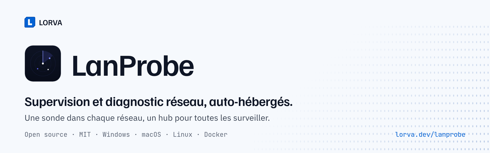

<p align="center"><a href="README.md">English</a> · <b>Français</b> · <a href="README.es.md">Español</a></p>

<picture>
  <source media="(prefers-color-scheme: dark)" srcset="docs/assets/banner-fr-dark.png">
  
</picture>

# LanProbe

[](https://github.com/Ops-Lorva/lanprobe/releases/latest)
[](#licence)

**Supervision et diagnostic réseau auto-hébergés — une sonde dans chaque réseau, un hub pour toutes les surveiller.**
Profils réseau, ping monitor, SLA, découverte, port scan, speed test et hub auto-hébergé. Page produit : [lorva.dev/lanprobe](https://lorva.dev/lanprobe/).

<!-- capture : tableau de bord du hub — vue du parc avec plusieurs sites et sondes -->

---

## Le problème

Surveiller un réseau oblige d'ordinaire à un compromis. Les grosses suites de supervision sont démesurées pour une poignée de sites. Les services cloud veulent un agent qui remonte vers les serveurs de quelqu'un d'autre — et supposent que vous pouvez ouvrir un accès entrant. Sur le site d'un client, dans un labo ou sur un réseau domestique derrière un CGNAT, c'est souvent impossible, et vous ne tenez pas forcément à ce que votre topologie vive dans le cloud d'un éditeur. Le diagnostic de tous les jours, lui, reste éparpillé dans une douzaine d'utilitaires à usage unique : un pour pinguer, un pour scanner les ports, un pour balayer le sous-réseau, un pour mesurer le débit.

## Ce que fait LanProbe

LanProbe réunit ces utilitaires en un seul outil et surveille les hôtes **depuis l'intérieur même du réseau**. Il est **auto-hébergé et open source** : les sondes tournent sur vos machines, le hub tourne sur un serveur que vous contrôlez, et les mesures ne quittent jamais votre infrastructure.

Il se présente en **deux morceaux**, et il faut connaître la répartition avant d'installer quoi que ce soit :

| | Rôle |
|---|---|
| **La sonde** | Mesure. Application de bureau (Windows / macOS / Linux) ou service headless. C'est elle qui pingue, scanne, teste le débit — depuis l'intérieur du réseau observé. |
| **Le hub** | Regarde. Un conteneur Docker chez vous, qui rassemble toutes les sondes derrière **une seule adresse et une seule authentification**. |

Une sonde seule est parfaitement utilisable : ouvrez la fenêtre, elle mesure. Le hub devient utile dès qu'il y a plusieurs sites, plusieurs machines, ou qu'on veut regarder sans être devant l'écran.

**Le sens de la connexion compte.** Le hub ne joint jamais une sonde — il n'a aucune route vers son réseau, et c'est voulu. C'est la sonde qui appelle le hub, en sortie. Il n'y a donc **aucun port à ouvrir** en entrée sur le réseau surveillé, ni VPN à monter.

## Pour qui

- **Les informaticiens indépendants et les petits infogérants** qui surveillent plusieurs sites clients depuis un seul endroit — avec des comptes limités par site, pour qu'un client voie son parc et pas celui des autres.
- **Les administrateurs réseau et système** qui veulent un historique de disponibilité, des chiffres de SLA et une vue du parc sans monter une pile de supervision lourde.
- **Les auto-hébergeurs et les home labs**, y compris derrière un CGNAT ou un NAT où rien ne peut être ouvert en entrée.
- **Quiconque fait du diagnostic sur le terrain**, change souvent d'interface et veut ping, scan, découverte et speed test dans une seule fenêtre plutôt qu'un tiroir plein d'outils.

## En bref

- **Mesurer** — ping monitor multi-hôtes avec latence en direct, découverte CIDR asynchrone (IP / nom d'hôte / MAC), port scan TCP avec profils intégrés et personnalisés, speed test lié à l'interface (Ookla ou iperf3), statut internet par double sonde ICMP + HTTP, et profils réseau nommés appliqués en un clic.
- **Rendre compte** — uptime % par hôte, latence moyenne / min / max / P95, export CSV et XLSX.
- **Parc** — un hub auto-hébergé qui rassemble toutes les sondes derrière une seule adresse, organisé par site, avec un périmètre par site sur les comptes et un archivage qui sort un client du parc sans effacer son historique.
- **Sécuriser et exploiter** — comptes avec rôles `admin` / `operator` / `viewer`, journal d'audit complet, TOTP et clés d'accès, alertes par e-mail et webhook (Slack, Discord, ntfy…), et sauvegarde / restauration automatiques et autonomes.

---

## Fonctionnalités

| Module | Description |
|--------|-------------|
| **Profils réseau** | Configurations IP statique ou DHCP nommées, appliquées en un clic |
| **Ping Monitor** | Surveillance ICMP continue de plusieurs hôtes, latence en direct, seuils configurables |
| **Export SLA** | Uptime % par hôte, latence moyenne / min / max / P95 — export CSV |
| **Découverte réseau** | Scan CIDR asynchrone : IP, nom d'hôte, adresse MAC |
| **Port Scan** | Scan TCP avec profils intégrés (common, web, full) et personnalisés |
| **Speed Test** | Ookla ou iperf3, **lié à l'interface sélectionnée** |
| **Statut internet** | Double sonde ICMP + HTTP, IP publique, pourcentage d'uptime |
| **Hub auto-hébergé** | Sites, sondes, comptes, rôles, journal d'audit, alertes, sauvegardes |
| **Second facteur et clés d'accès** | TOTP partout, clés d'accès en HTTPS — avec une commande de secours en cas de téléphone perdu |
| **Périmètre par site** | Un compte ne voit que certains sites : montrer son parc à un client sans montrer ceux des autres |
| **Archivage** | Un client qu'on ne sert plus sort du parc sans que rien ne soit supprimé — son rapport SLA reste exportable |
| **Thème** | Sombre / clair / système, 6 palettes d'accent |

### La règle qui gouverne tout : l'interface sélectionnée

**Tout le trafic d'une sonde sort par l'interface que vous avez choisie.** Les mesures, mais aussi son battement de cœur vers le hub et l'envoi de ses relevés.

Ce n'est pas un détail d'implémentation. On peut avoir internet sur `eth1` et pas sur `eth0`, et `eth0` est justement celui qu'on cherche à éprouver. Une sonde qui mesurerait un lien mort tout en répondant « je vais bien » par un autre lien affirmerait quelque chose qu'elle n'a pas vérifié.

Conséquence à connaître : si l'interface sélectionnée n'a plus d'adresse, la sonde **cesse de battre** et passe « sans nouvelles » dans le parc. C'est la vérité de l'interface observée, pas une panne de la sonde.

---

## Installation

### Application de bureau

Téléchargez depuis les [releases](https://github.com/Ops-Lorva/lanprobe/releases/latest) :

| Plateforme | Fichier |
|---|---|
| Windows | `lanprobe_vX.Y.Z_x64-setup.exe` |
| macOS | `lanprobe_vX.Y.Z_universal.pkg` (signé + notarisé) |
| Linux | `lanprobe_vX.Y.Z_amd64.deb` |

Sur macOS, le `.pkg` provisionne les droits sudoers nécessaires au changement d'IP. Sur Linux, le paquet pose `CAP_NET_RAW` et `CAP_NET_ADMIN` sur le binaire : les ping ICMP bruts et les changements d'interface fonctionnent sans être root.

---

### Sonde headless sur Debian / Ubuntu

Pour un Raspberry Pi, une VM ou un serveur sans interface graphique.

```bash
curl -fsSL -o install-server.sh https://raw.githubusercontent.com/Ops-Lorva/lanprobe/main/install-server.sh
sudo bash install-server.sh
```

**La sonde headless n'écoute sur aucun port.** L'interface web, c'est le hub : une sonde qui exposerait la sienne serait une seconde surface à sécuriser pour montrer les mêmes mesures. On la pilote en ligne de commande, et on la consulte depuis le hub.

**Rattachement.** Dans le hub, créez un code d'enrôlement (Parc → « + » sur un site), puis :

```bash
sudo -u lanprobe lanprobe-server --config-dir /var/lib/lanprobe \
     enroll --hub https://hub.exemple.fr --code A1B2-C3D4

sudo systemctl enable --now lanprobe-server
```

Le code vaut 15 minutes et ne sert qu'une fois. La sonde apparaît dans le parc au premier battement, donc en moins d'une minute.

**Commandes :**

```bash
lanprobe-server run         # mesure et envoie, jusqu'à Ctrl-C (action par défaut)
lanprobe-server enroll      # rattache à un hub
lanprobe-server interfaces  # liste les interfaces réseau de cette machine
lanprobe-server status      # affiche le rattachement
lanprobe-server forget      # détache — le hub garde les mesures
```

**Choisir l'interface à mesurer.** Sans écran, il n'y a nulle part où la
choisir : c'est `--interface` qui s'en charge, sur `run` et sur `enroll` :

```bash
lanprobe-server interfaces              # en0  address 10.0.8.235/24  gateway 10.0.8.1  actif
lanprobe-server run --interface en0     # mémorisée — inutile de la répéter
```

**Sans elle, la sonde suit la route par défaut du système et ne remonte ni
passerelle ni adresses locales.** La colonne *Passerelle* du rapport SLA et les
étiquettes réseau restent alors vides pour de bon — la sonde a l'air en bonne
santé et ne dit rien de l'endroit où elle se trouve. Un nom inconnu échoue tout
de suite et liste ceux qui existent ; un nom mémorisé mais absent pour l'instant
(un adaptateur débranché, un VPN arrêté) est conservé et signalé, jamais
abandonné en silence.

La liste indique l'état de chaque lien : `actif`, `activé, sans porteuse`
(activé mais câble débranché — vérifiez le câble, pas la configuration), ou
`inactif`. Sur Linux, l'état est lu dans le noyau ; sur macOS et Windows il est
encore toujours affiché comme actif, donc ne vous y fiez que sur Linux pour
l'instant.

`--config-dir` s'applique à toutes les commandes. Défaut : `~/.config/lanprobe`, et `/var/lib/lanprobe` pour le service systemd.

Pour un déploiement scripté, `--username`, `--password` et `--site` remplacent `--code`. À éviter sur une machine que vous ne contrôlez pas : un hôte compromis ne devrait pas recevoir les identifiants du hub.

**Pare-feu :** rien à ouvrir en entrée. Il faut seulement que la sonde puisse joindre l'adresse du hub en sortie.

**Un hub à certificat auto-signé.** La sonde ne l'accepte pas les yeux fermés
— elle l'**épingle**. Enrôlez sans rien dire, la commande s'arrête et affiche
l'empreinte qu'elle a vue :

```
Le certificat de hub.exemple.fr ne se vérifie pas.
  empreinte SHA-256 : 39:73:1A:…:7F:0D
  --pin 39:73:1A:…:7F:0D
```

Comparez-la à celle qu'affiche votre hub, puis relancez avec `--pin`. Ensuite,
seul ce certificat-là est accepté.

On n'épingle que ce qui en a besoin : un certificat qui se vérifie tout seul
est laissé tranquille, sinon un renouvellement chez une autorité publique
couperait la sonde tous les trois mois.

`--allow-self-signed` existe toujours et fonctionne toujours, pour les
sondes déjà déployées avec. Préférez `--pin` : l'ancienne option accepte
**n'importe quel** certificat, donc n'importe qui sur le chemin peut se faire
passer pour le hub et repartir avec le jeton de la sonde.

**Clé de scellement.** Les secrets locaux de la sonde — son jeton de hub — sont chiffrés au repos. La clé est créée au premier démarrage dans le dossier de configuration. Pour la fournir vous-même (conteneur immuable, gestionnaire de secrets) :

```bash
head -c 32 /dev/urandom | base64        # 32 octets aléatoires
# puis, en drop-in systemd :
# [Service]
# Environment=LANPROBE_SECRET_KEY=<base64-32-octets>
```

---

### Hub auto-hébergé (Docker)

Un seul conteneur : le hub, sa base SQLite, et un InfluxDB embarqué. **Nous n'hébergeons rien** — tout tourne sur une machine que vous contrôlez.

```bash
git clone https://github.com/Ops-Lorva/lanprobe.git && cd lanprobe
docker compose up -d
docker compose logs lanprobe-web | grep -i token
```

Le fichier compose publie le hub sur **`127.0.0.1:8080` seulement** : ouvrez `http://localhost:8080` sur cette machine, ou placez votre reverse proxy devant. Pour le joindre depuis le LAN sans proxy, remplacez la ligne par `"8080:8080"` — en sachant que les mots de passe circuleront alors en clair.

Ouvrez le hub, collez le jeton, créez le compte administrateur — le jeton est consommé au premier usage. Puis **Enrôler une sonde** : le hub donne un code court, valable 15 minutes. Dans LanProbe, **Réglages → Connexion au serveur**, saisissez l'adresse du hub et ce code. Aucun mot de passe n'atteint la machine surveillée.

Les comptes portent un rôle (`admin` / `operator` / `viewer`), chaque action est écrite au journal d'audit, et les bascules hors ligne / en ligne peuvent partir par e-mail ou par webhook (Slack, Discord, ntfy…). L'[API complète est décrite dans le contrat](docs/lanprobe-web-contrat.md).

**Deux pièges qui coûtent dix minutes :**
- le jeton de configuration ne se lit **que** dans `docker logs` — l'interface ne l'affiche jamais ;
- si cette machine a déjà été jointe en HTTPS, le navigateur garde un cookie `Secure` qui bloque silencieusement la connexion en HTTP ensuite : la connexion semble aboutir puis revient à l'écran de login, **sans erreur**. Fenêtre privée, ou vider les cookies du site.

Le hub sert **en clair par défaut**, pour vivre derrière votre propre reverse proxy. Un interrupteur dans **Réglages → Général** — ou `--tls` — lui fait terminer le TLS lui-même avec un certificat auto-signé, ce qui suffit sur un LAN. L'effet est **au redémarrage**, l'adresse change, et les sondes déjà enrôlées sur l'ancienne devront voir la leur corrigée. Les clés d'accès l'exigent (ou un proxy) : les navigateurs refusent WebAuthn hors contexte sécurisé. Le port d'InfluxDB (`8086`) est fermé par défaut : ne l'ouvrez que pour y brancher Grafana — les sondes n'en ont jamais besoin.

**Exposer un hub sur Internet** (un hub de démo par exemple) : TLS sur le reverse proxy, le réseau du proxy dans **Proxies de confiance**, **URL publique du hub** renseignée. Le hub limite les tentatives de connexion, d'appairage, d'enrôlement et de jeton d'appareil par adresse et par compte (HTTP 429), et refuse l'authentification Basic aux comptes qui ont un second facteur. Un compte partagé peut passer en **mode démo** (*Réglages → Comptes*) : mot de passe, second facteur, clés d'accès et langue verrouillés, il ne voit que l'appareil d'où il appelle, et ses appareils appairés sont révoqués après `LANPROBE_WEB_DEMO_DEVICE_DAYS` jours (7 par défaut). Donnez-lui le rôle `viewer` et restreignez-le au site de démo : un compte restreint ne lit plus les réglages d'infrastructure du hub. Détails dans le [contrat, § 27](docs/lanprobe-web-contrat.md).

Le hub a **sa propre version**, indépendante de l'application.

#### Sauvegarde

Le hub sauvegarde tout seul, comme Sonarr : une archive complète dans son dossier de sauvegarde, et pour restaurer on redonne le fichier. Réglable dans **Réglages → Stockage** (cadence, nombre d'archives conservées).

**Une archive contient `secret.key`**, qui déchiffre les mots de passe de notification et les URL de webhook. Traitez ce dossier comme un secret.

En ligne de commande, pour un cron sur l'hôte :

```bash
docker exec lanprobe-web lanprobe-web backup     # produit une archive, applique la rétention
docker exec lanprobe-web lanprobe-web backups    # liste
```

La restauration se fait **conteneur en marche** puis redémarrage : le volet InfluxDB
parle à la base de séries, qui doit répondre. Voir « Restaurer une archive » ci-dessous.

#### Se remettre dedans quand on est dehors

C'est de l'auto-hébergé : **il n'y a ni e-mail de récupération, ni support**.
Toutes les portes de secours passent par le conteneur — c'est-à-dire par un
accès à la machine, ce qui est la seule chose qui puisse en tenir lieu.

Chacune écrit au journal d'audit : elles contournent la connexion, elles
doivent laisser une trace.

| Situation | Commande |
|---|---|
| Mot de passe administrateur perdu | `docker exec lanprobe-web lanprobe-web reset-password admin <nouveau>` |
| Téléphone perdu, second facteur bloquant | `docker exec lanprobe-web lanprobe-web disable-totp <compte>` |
| Compte désactivé par erreur | `reset-password` le réactive au passage |
| Rôle perdu (plus aucun administrateur) | `reset-password <compte> <mdp> --promote` |

**`disable-totp` retire aussi le secret**, pas seulement le drapeau. Un
ancien code ne doit pas revivre sur un QR que vous croirez neuf : à la
réactivation, l'application d'authentification devra rescanner.

**Les clés d'accès n'ont pas de commande de secours, et c'est voulu.** Il
en faut plusieurs — le portable *et* le téléphone — ou garder un mot de passe
qui marche. Une clé d'accès ne remplace pas le mot de passe tant qu'elle est
seule.

**Un second facteur illisible bloque la connexion, exprès.** Si vous
restaurez un volume sans son `secret.key`, le hub sait encore que le compte
exige un second facteur mais ne peut plus vérifier les codes : il **refuse**
plutôt que de repasser au mot de passe seul, et affiche la commande ci-dessus.
Laisser passer désactiverait la protection en silence, le jour précis où l'on
a des raisons de s'en méfier.

#### Restaurer une archive

```bash
# 1. le conteneur doit TOURNER : la restauration des mesures parle à InfluxDB
docker cp mon-archive.zip lanprobe-web:/backup/
docker exec lanprobe-web lanprobe-web restore mon-archive.zip --force

# 2. redémarrer : le processus en cours sert encore l'ancienne base
docker restart lanprobe-web
```

**`--force` est exigé** dès que le volume porte déjà des données : une
restauration qui écrase sans le demander n'est pas une restauration, c'est un
accident.

**L'ancien état est mis de côté**, pas supprimé : `avant-restauration-<date>`
dans le volume du hub.

Une archive produite par un hub **plus récent** est refusée. Son schéma est
en avance sur ce binaire, et les migrations ne reviennent pas en arrière.

---

## Dépannage

### Derrière Traefik (ou tout reverse proxy)

Derrière un reverse proxy le hub ne termine pas le TLS lui-même, et il **ne fait jamais confiance aux en-têtes transmis par défaut**. Deux symptômes en découlent, tous deux réglés dans *Réglages → Général*, sans redémarrage.

**1. Le téléphone refuse l'appairage : « App Transport Security policy requires the use of a secure connection ».**
Le QR d'appairage portait `hub=http://…`. Tant que le hub ne connaît pas son adresse publique, il compose l'invitation depuis l'en-tête `Host` et son propre schéma — `http` en clair derrière un proxy. iOS le refuse.
→ Renseignez **URL publique du hub** (`hub_public_url`) avec l'adresse tapée dans le navigateur, par exemple `https://lanprobe.exemple.fr`, puis générez un **nouveau** code d'appairage : une invitation déjà affichée garde l'ancien schéma. Sans ce réglage, le hub suit `X-Forwarded-Proto`, mais seulement venant d'un proxy listé dans **Proxies de confiance** (point 2).
Ce réglage décide aussi de l'adresse où les sondes écrivent leurs mesures (même hôte, port d'InfluxDB), sauf si `LANPROBE_WEB_INFLUX_ADVERTISE_URL` est posé — derrière un seul proxy sur le même hôte, c'est ce qu'on veut.

**2. Tous les appareils appairés (et toutes les sondes) affichent l'adresse du proxy, par exemple `172.32.0.3`, au lieu de leur IP publique.**
`X-Forwarded-For` est un en-tête écrit par le client : le hub ne le lit que depuis les proxies listés dans **Proxies de confiance** (`trusted_proxies`), et la liste est vide à l'installation — le hub note donc l'autre bout de la socket, votre proxy.
→ Ajoutez le réseau du proxy en CIDR, séparés par des virgules s'il y en a plusieurs : pour Traefik sous Docker, le réseau Docker qu'il partage avec le hub, par exemple `172.32.0.0/16`. Les adresses se mettent à jour à la prochaine vue de chaque appareil.
Ne faites confiance qu'à ce que vous contrôlez. Traefik lui-même ne doit faire confiance qu'à son amont (pour Cloudflare, `entryPoints.<ep>.forwardedHeaders.trustedIPs` avec les plages Cloudflare), sinon n'importe qui forge l'adresse que le hub enregistre.

Étiquettes Traefik minimales pour le conteneur du hub (TLS sur Traefik, HTTP en clair vers le hub) :

```yaml
labels:
  - "traefik.http.routers.lanprobe.rule=Host(`lanprobe.exemple.fr`)"
  - "traefik.http.routers.lanprobe.entrypoints=websecure"
  - "traefik.http.routers.lanprobe.tls.certresolver=letsencrypt"
  - "traefik.http.services.lanprobe.loadbalancer.server.port=8080"
```

## Compiler depuis les sources

**Prérequis**

- [Rust](https://rustup.rs/) ≥ 1.85 (edition 2024)
- [Node.js](https://nodejs.org/) ≥ 18
- **Linux desktop :** `libwebkit2gtk-4.1-dev libgtk-3-dev librsvg2-dev`
- **Linux serveur uniquement :** `libssl-dev pkg-config` (aucune dépendance GUI)
- **macOS :** `xcode-select --install`
- **Windows :** [WebView2](https://developer.microsoft.com/en-us/microsoft-edge/webview2/) (pré-installé sur Windows 11)

```bash
git clone https://github.com/Ops-Lorva/lanprobe.git
cd lanprobe
npm install
```

```bash
npm run tauri build                      # application de bureau
cargo build --release -p lanprobe-server # sonde headless, sans GUI
npm run build:web && cargo build --release -p lanprobe-web  # hub
```

`npm run build:web` **avant** le hub : l'interface est embarquée dans le binaire, et un hub construit sans elle démarre puis répond une erreur explicite à la place de la page.

---

## Développement

```bash
npm run tauri dev        # bureau, avec rechargement à chaud
npm run dev:web          # interface du hub, proxy vers un hub local
npm run check            # TypeScript / Svelte, application
npm test                 # svelte-check + Vitest, interface du hub
cargo test --workspace   # Rust
```

**Il n'y a pas de CI de test.** Le seul workflow est déclenché par un tag et ne fait que construire. `cargo test` et `npm test` sont des gestes **manuels**, à faire avant de déployer. Ce que couvre chaque suite, et pourquoi les tests de l'interface existent, est décrit au § 21 du [contrat](docs/lanprobe-web-contrat.md).

---

## Stack technique

```
Sondes    →  Rust (Tauri 2 · tokio · reqwest) — aucun serveur HTTP
Hub       →  Rust (axum · rusqlite · InfluxDB 2)
Interface →  Svelte 5 + TypeScript, deux frontends distincts
Thème     →  Propriétés CSS · sombre / clair / système · 6 palettes
i18n      →  svelte-i18n — anglais · français · espagnol, des deux côtés
Bundles   →  .exe NSIS · .dmg / .pkg · .deb · .deb headless · image Docker
```

### Workspace Cargo

```
lanprobe/
├── src-tauri/                  # Shell Tauri — commandes, cycle de vie
├── crates/
│   ├── lanprobe-core/          # Mesure : ping, découverte, ports, speedtest, SLA
│   ├── lanprobe-server/        # Cœur de la sonde : ordonnanceur, tampon, rattachement au hub
│   └── lanprobe-web/           # Hub : API, SQLite, InfluxDB, sauvegardes
├── src/                        # Interface de l'application (Svelte 5)
└── web-ui/                     # Interface du hub (Svelte 5), embarquée dans son binaire
```

`lanprobe-server` **n'est pas un serveur** malgré son nom : il n'écoute sur aucun port. Il porte l'ordonnanceur des mesures, le tampon d'export et le rattachement au hub, partagés entre l'application de bureau et le binaire headless.

---

## Compatibilité

| OS | Version | Architecture |
|----|---------|--------------|
| Windows | 10, 11 | x64 |
| macOS | 12 Monterey+ | Intel · Apple Silicon · universal |
| Linux (bureau) | Debian 12+ · Ubuntu 22.04+ | x64 |
| Linux (sonde headless) | Debian 11+ · Ubuntu 20.04+ · toute distro systemd | x64 |
| Hub | Toute machine avec Docker | x64 · arm64 |

---

## Release

Un workflow GitHub Actions compile toutes les plateformes en parallèle et publie une seule GitHub Release :

| Job | Runner | Artefacts |
|-----|--------|-----------|
| `build-linux` | `ubuntu-22.04` | `lanprobe_vX.Y.Z_amd64.deb` |
| `build-linux-server` | `ubuntu-24.04` | `lanprobe-server_vX.Y.Z_amd64.deb` |
| `build-windows` | `windows-latest` | `lanprobe_vX.Y.Z_x64-setup.exe` |
| `build-macos` | `macos-latest` | `universal.dmg` + `universal.pkg` (signé + notarisé) |
| `release` | `ubuntu-22.04` | collecte les artefacts, publie la Release |

**Deux produits, deux tags.** L'application et le hub ne sortent pas
ensemble et n'ont pas la même version — un tag `v1.0.0` ne dirait pas lequel
il désigne.

```bash
git tag app-v2.1.0 && git push origin app-v2.1.0   # application
git tag hub-1.0.0  && git push origin hub-1.0.0    # hub (image Docker)
```

La version vient du tag ; elle n'est pas écrite dans `Cargo.toml`, qui reste à
`0.0.0` pour l'application.

La forme ancienne `v2.1.0` reste acceptée pour l'application, et le restera
tant que des versions 2.0.x tournent : leur updater embarqué ne reconnaît
qu'elle, et le retirer les couperait des mises à jour **sans le moindre
message**. Les fichiers publiés gardent toujours la forme `lanprobe_v2.1.0_…`,
quel que soit le préfixe du tag.

Le hub publie une image Docker sur `ghcr.io`, épinglée à sa version. Pas de
`latest` : une image qui change sous les pieds d'un `docker compose pull` est
exactement la façon dont on saute une majeure sans le vouloir.

---

## Feuille de route

- [x] Profils réseau (IP statique / DHCP)
- [x] Ping monitor multi-hôtes avec graphiques de latence
- [x] Découverte réseau (CIDR — IP / nom d'hôte / MAC)
- [x] Port scan TCP, profils intégrés et personnalisés
- [x] SLA — uptime %, latence moyenne / min / max / P95, export CSV
- [x] Speed test lié à l'interface sélectionnée (Ookla + iperf3)
- [x] Thème sombre / clair / système, 6 palettes
- [x] i18n — anglais, français, espagnol
- [x] `.pkg` macOS signé + notarisé, provisionnement sudoers
- [x] `.deb` headless avec service systemd et capabilities
- [x] **Hub auto-hébergé** — Docker, InfluxDB embarqué, sites, comptes, rôles, audit
- [x] **Alertes** — e-mail et webhook, abonnement par site et par sonde
- [x] **Sauvegarde et restauration** du hub, automatiques
- [x] **Tout le trafic lié à l'interface sélectionnée**, battement de cœur compris
- [x] Retrait du serveur web de la sonde — un seul endroit à sécuriser
- [ ] Les cinq onglets par sonde dans le hub, et le déclenchement à distance
- [x] Périmètre par site sur les comptes
- [x] 2FA et clés d'accès sur les comptes du hub

---

## Contribuer

Les pull requests sont les bienvenues. Pour un changement significatif, ouvrez une issue au préalable pour discuter de l'approche.

---

## Licence

MIT.

---

<p align="center"><sub>Construit avec Tauri · Rust · Svelte — LanProbe est conçu par <a href="https://lorva.dev">LORVA</a>, un studio logiciel indépendant.</sub></p>
